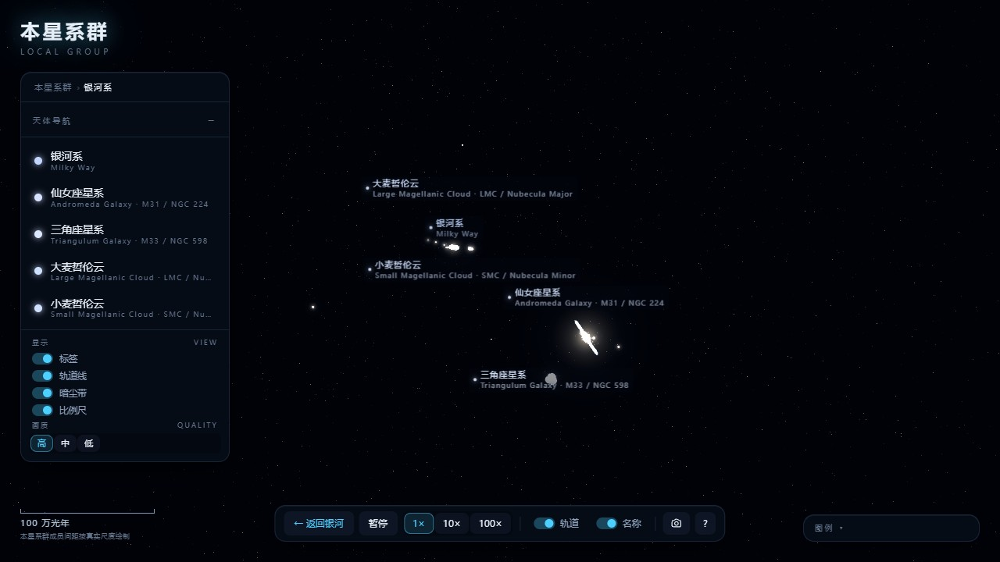
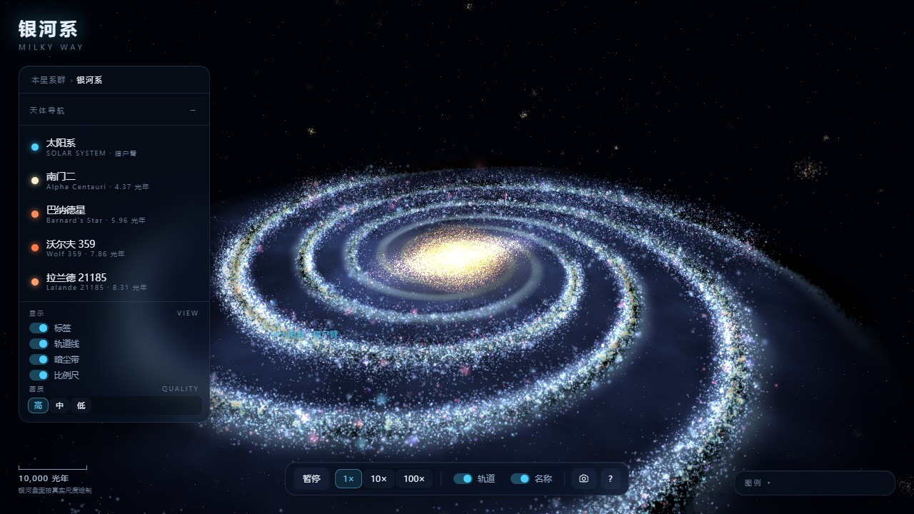
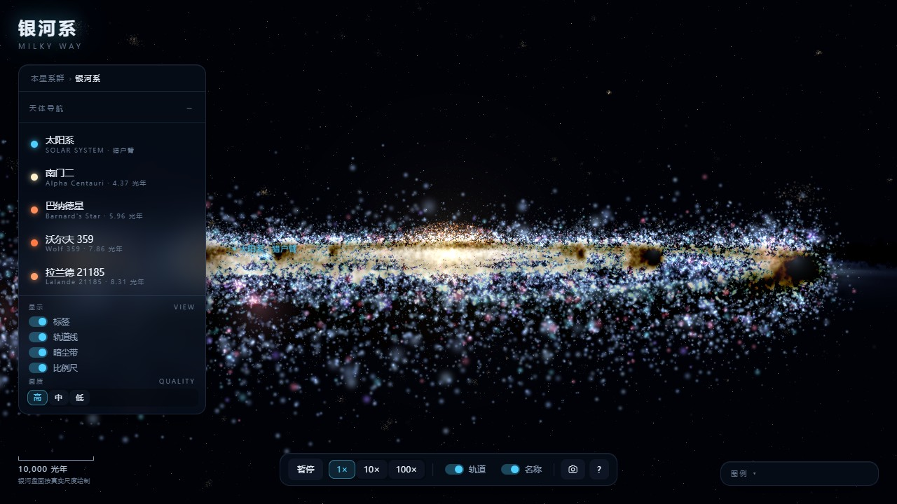
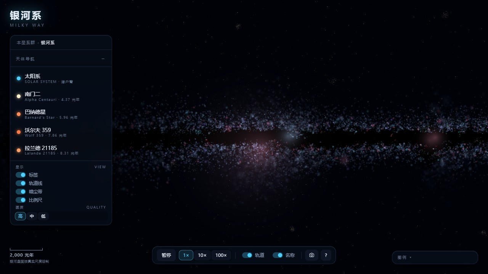
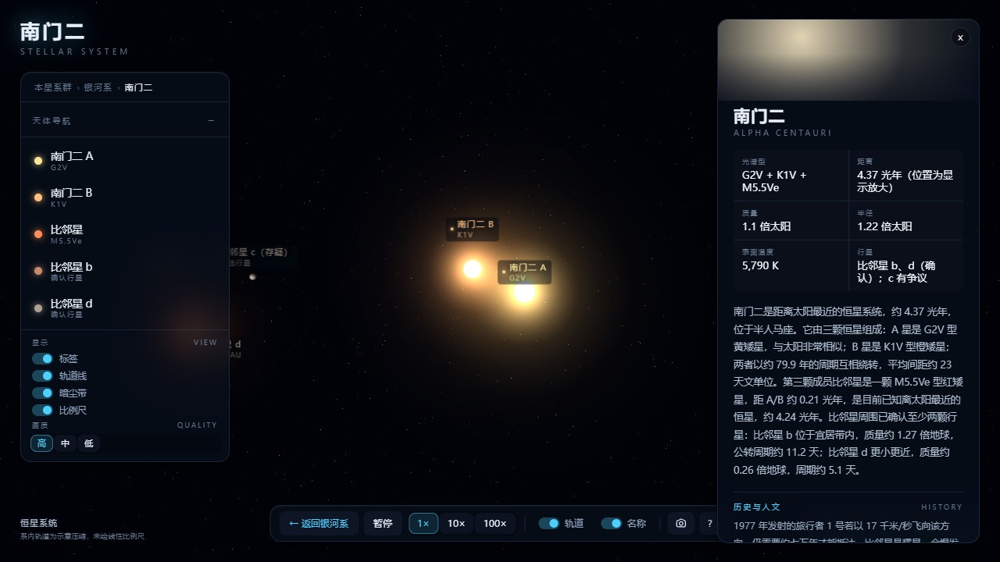
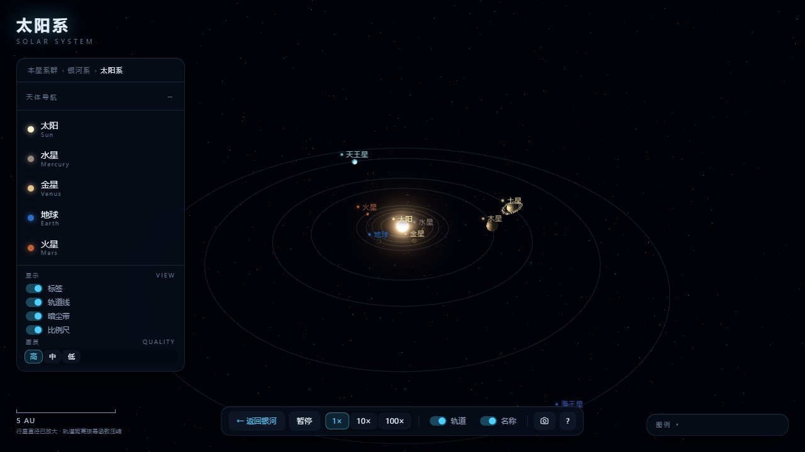
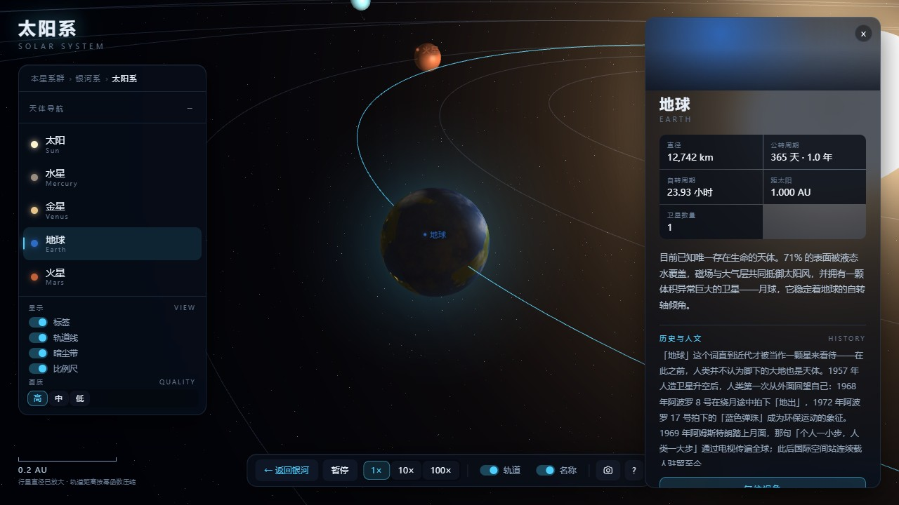
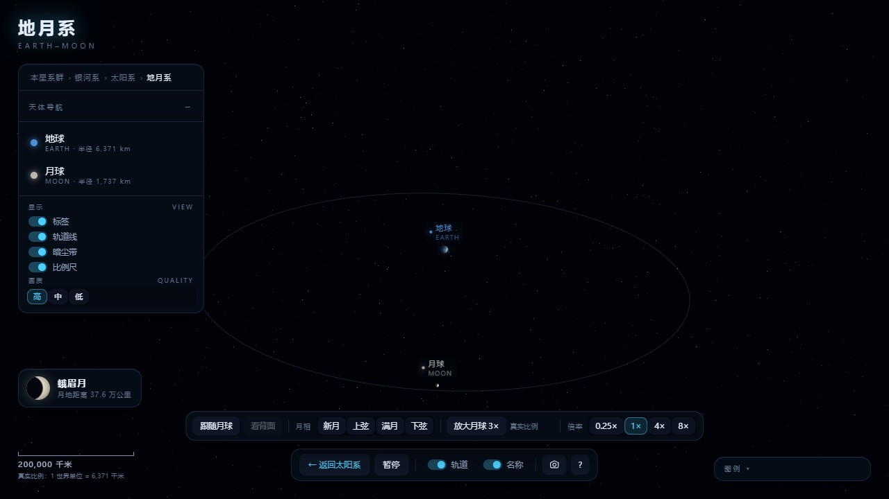

# 银河系 · 3D 星际漫游

零依赖、单文件、按真实银河系结构建模的三维可视化。**双击 `index.html` 就能运行**——不联网、不装包、不依赖服务器、CDN 或任何外部资源。

从本星系群一路放大到地月系：银河系的中央棒与四条旋臂、仙女座星系、南门二三合星、太阳系八大行星、地球与月球的潮汐锁定和月相，全部由 WebGL 实时渲染。行星表面纹理在运行时用分形噪声逐像素生成，不加载任何图片。

## 预览

| 本星系群 | 银河系俯视 | 银河系侧视 | 银河盘内 |
|---|---|---|---|
|  |  |  |  |

| 南门二三合星 | 太阳系 | 地球聚焦 | 地月系 |
|---|---|---|---|
|  |  |  |  |

侧视图是一条中间鼓起的细长光带，俯视图能看到中央棒和四条主旋臂，盘内视角能看见暗尘带把银河切成裂缝。

## 快速开始

1. 下载仓库（或只下载 `index.html`）。
2. 用浏览器打开 `index.html`。

不需要安装、不需要启动服务器。`file://` 双击即可，离线可用。浏览器需要支持 WebGL（优先 WebGL 2，自动回退 WebGL 1）。

也可以用任意静态服务器托管。

## 能看什么

五层尺度，逐级下钻，也可以直接跳转：

| 层级 | 内容 |
|---|---|
| **本星系群** | 银河系、仙女座星系（M31）、三角座星系（M33）、大小麦哲伦云，以及 M32、M110、NGC 6822、IC 10、人马座矮椭球星系。每个成员都有中文名、编号、距离和一段介绍。 |
| **银河系** | 直径约 10 万光年的棒旋星系：4.2 kpc 的中央棒、明亮核球、四条主旋臂、猎户臂、薄盘与厚盘、银晕、暗尘带与 HII 恒星形成区。支持俯视 / 侧视 / 盘内三种视角。 |
| **恒星系统** | 南门二（三合星）、天狼星（A + 白矮星 B）、南河三、巴纳德星、沃尔夫 359、拉兰德 21185、天苑四、织女星、北极星、参宿四。按 A/B/C/D 分级渲染，不编造行星。 |
| **太阳系** | 太阳与八大行星、轨道、卫星、行星环，以及每颗天体的资料与科学注记。 |
| **地月系** | 真实比例的地球与月球：潮汐锁定、椭圆轨道与 5.14° 倾角、随公转自然产生的月相、夜半球城市灯光、云层动画。 |
| **行星聚焦** | 点击任意行星贴近观察，查看参数与介绍，可跟随公转。 |

层级之间用相机补间与双层淡入淡出过渡，画面不会黑屏。左下角比例尺会随缩放实时更新并注明「真实尺度绘制」或「已压缩」，避免误读。

## 怎么操作

### 鼠标

| 操作 | 方式 |
|---|---|
| 旋转视角 | 左键拖动（任意方向） |
| 平移注视点 | `Shift` + 左键拖动 / 右键拖动 |
| 缩放 | 滚轮 |
| 进入 / 聚焦 | 单击对象；单击空白处朝该点推进；双击快速放大 |
| 拖出点击 | 鼠标移动超过 8px 判定为拖动，不触发点击 |

### 触屏

| 操作 | 方式 |
|---|---|
| 旋转视角 | 单指拖动 |
| 缩放 | 双指捏合 |
| 平移注视点 | 双指拖动 |
| 进入 / 聚焦 | 单击；双击快速放大 |

### 键盘

| 按键 | 功能 |
|---|---|
| `1` / `2` / `3` | 银河层：俯视 / 侧视 / 盘内视角。其他层：`1`–`3` 是行星编号 |
| `0`–`8` | 直达太阳与八大行星（太阳系层） |
| `F` | 聚焦画面中心最近的可见天体 |
| `R` | 复位当前层级的视角 |
| `Esc` | 逐层退回：帮助 → 演示 → 聚焦复位 → 地月系 / 恒星系统 / 太阳系 / 本星系群 |
| `W` `A` `S` `D` / 方向键 | 平移 |
| `+` / `-` | 缩放 |
| `Space` | 暂停 / 继续 |
| `[` / `]` | 时间流速 1× / 10× / 100× |
| `H` | 演示模式（自动巡游，任意输入即退出） |
| `?` 或 `/` | 打开 / 关闭帮助 |

完整的操作说明也可以在页面内按 `?` 查看。界面上的每个键都有对应的按钮，不依赖键盘也能完成全部操作。

## 科学说明

### 数据来源

银河系结构参数（棒长、旋臂倾角、盘厚、太阳距银心 8.3 kpc 等）参照大尺度巡天的常用模型；行星参数以 NASA 公开数据为准；恒星的距离、光谱型与质量取常用观测值。数值有观测分歧时标「约」，有争议时直接写「候选，尚待确认」（如巴纳德星的行星、比邻星 c）。

### 比例与视觉压缩

不同层级用不同尺度，**每个层级内部尽量保持真实比例，跨层级必然跳变**：

- **银河层**：1 世界单位 = 20 光年。盘半径 50,000 光年，太阳距银心约 2.7 万光年，中央棒约 1.37 万光年。这一段是真实比例。
- **邻近恒星**：真实距离只有 4–25 光年，在银河层里不到 0.25 个世界单位，会全部挤在太阳标记上。因此它们在银盘上被排布进一个「太阳附近放大示意区」，用虚线与太阳相连，图例中写明「距离已放大显示」。
- **本星系群**：1 世界单位 = 1,000 光年，仙女座星系距离约 254 万光年。
- **太阳系**：行星大小经过放大、轨道距离经过非线性压缩，两者**不对应同一比例尺**，图例中注明。
- **地月系**：回到真实比例。地球半径 = 1 世界单位（6,371 km），月球 = 0.273，地月距离 = 60.3 个地球半径。时间尺度是 4 现实秒 = 1 天。

### 时间

全局时间流速可调 1× / 10× / 100×，可暂停，也作用于月球公转。地月系有独立的 0.25×–8× 倍率，便于慢速观察自转与月相。地月系固定太阳方向，只模拟月球绕地球的公转，不模拟地球绕太阳的公转，因此这一层的「月相周期」等于恒星月（约 27.3 天），而不是朔望月（29.53 天）。

## 画质与性能

三种画质档位：

| 档位 | 银河粒子数 | 特性 |
|---|---|---|
| `high`（默认） | 600,000 | 全效果：暗尘带、HII 区、银晕、星团、云层 |
| `mid` | 390,000 | 减少粒子与装饰 |
| `low` | 210,000 | 关闭暗尘与星团、像素比限制为 1 |

首屏加载完成后会自动采样帧率：平均帧时间超过 1/20 秒降到低画质，超过 1/32 秒降到中画质（只降不升）。也可以在地址后强制指定：

```
index.html?quality=high
index.html?quality=mid
index.html?quality=low
```

无头浏览器（SwiftShader 软件渲染）的帧时间只用于相对比较：high 约 217 ms / mid 约 100 ms / low 约 67 ms 每帧。这不代表真实显卡上的帧率，性能预算仍需在目标设备上实测。

页面在标签页隐藏时暂停渲染循环，减少耗电。

## 深链接

地址栏可以直达任意状态，便于分享与嵌入：

```
index.html#localgroup              进入本星系群
index.html#localgroup/m31          进入本星系群并聚焦仙女座星系
index.html#galaxy/r1200            银河层相机半径 1200
index.html#star/alphacen           进入南门二三合星系统
index.html#star/alphacen/proxima-b 进入南门二并聚焦比邻星 b
index.html#solar                   进入太阳系
index.html#body/earth              直接聚焦地球
index.html#body/saturn             直接聚焦土星
index.html#earthmoon               进入地月系
index.html#earthmoon/moon          进入地月系并聚焦月球
```

页面在层级变化、聚焦对象、缩放时会用 `history.replaceState` 同步地址栏，不产生历史记录。当前层级无法解释的哈希会被忽略，不会把用户从正在看的画面里硬拽走；非法 id 静默忽略。

## 目录结构

```
galaxy-3d/
├── index.html                    ← 全部内容（HTML + CSS + GLSL + JS）
├── README.md
├── LICENSE
├── docs/
│   ├── prompt-100k/              ← 10 万字实施规格（12 卷）
│   └── screenshots/              ← 各层级截图（JPEG）
└── tools/
    ├── smoke_test.py             ← 冒烟测试
    ├── acceptance_p3.py … p7.py  ← 分阶段自动验收（P3 17 项、P4 42、P5 52、P6 52、P7 80）
    └── capture_screens.py        ← 截图与帧时间采样
```

## 开发说明

### 单文件约束

所有代码都在 `index.html` 的一个 IIFE 里：手写列主序 4×4 矩阵库、6 个着色器程序、状态机、粒子生成、程序化纹理、交互与 UI。

不拆分模块、不使用 Three.js，是因为 `file://` 协议下浏览器禁止跨文件加载 ES 模块（CORS，origin 为 `null`），任何「从本地或 CDN import 一个 .js」的写法双击都会白屏。单文件换来的是真正的离线可运行。

### 修改数据表

- **天体数据**：`SUN` / `PLANETS`（行星与卫星）、`STARS`（邻近恒星系统）、`GALAXIES`（本星系群成员）。每项含中文名、英文名、编号、光谱型或星系类型、距离、参数与介绍文案。改这些表即可增删对象，侧栏、标签、拾取和深链接会一起更新。
- **尺度与相机**：`CFG` 里的 `galaxy` / `localGroup` / `starSystem` / `earthMoon` 分节，包括半径、相机范围、旋臂参数、粒子数、时间尺度。
- **状态机**：`ST` 七态与 `layerAlpha` / `layerTarget` 五层 alpha 控制层级过渡。

### 验证

```bash
pip install playwright
python -m playwright install chromium

python tools/smoke_test.py          # 冒烟：加载、WebGL、画面非空、无报错
python tools/acceptance_p7.py       # 交互与 UI（80 项）
python tools/capture_screens.py     # 重新生成 docs/screenshots 并采样帧时间
```

全部验收脚本用 Playwright 无头运行，通过页面内的 `window.__galaxy` 探针轮询状态，而不是固定等待。

## 已知限制

- 银河系的粒子分布是统计性示意，不是逐星测绘。旋臂位置基于大尺度巡天模型，不能用于天文导航。
- 太阳系行星的大小与轨道距离经过非线性压缩，不对应同一比例尺。
- 银河层中邻近恒星的位置沿「太阳附近放大示意区」排列，距离被显著放大。
- 行星与月球表面为程序化生成，不宣称是真实影像。
- 本星系群只包含主要成员与若干示意矮星系，不是完整目录。
- 未模拟引力演化、星系碰撞、超新星等动态事件。
- 月食、日食未模拟；地月系也不模拟地球绕太阳的公转。
- 目前在现代 Chromium 与 Firefox 内核验证；移动端性能取决于设备 GPU，会自动降档。

## 许可

[MIT License](LICENSE)。
