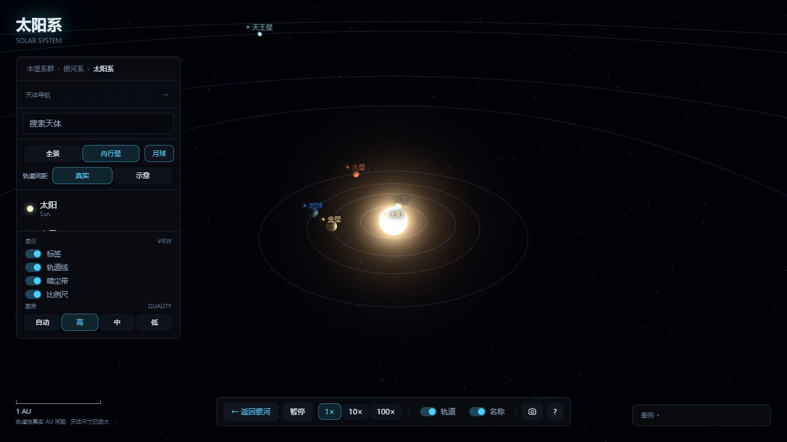

# 银河系 3D 星际漫游

一个可以离线双击打开的单文件 WebGL 天体可视化，把本星系群、银河系、邻近恒星、太阳系和地月系放在同一个可逐层探索的场景中。

**适合谁：** 想直观看天体结构与尺度关系的读者，以及学习 WebGL、相机导航和程序化纹理的开发者。

## 一图看懂


上图是依据公开源码绘制的原理示意，不是运行截图；以下表格与文字提供相同信息，便于小屏阅读。

## 现有实际画面



现有实际渲染截图：内行星视图。截图不代表本次新增硬件或平台验收。

## 主链路与源码

| 步骤 | 做了什么 | 代码或说明入口 |
| --- | --- | --- |
| 1. 选择天体 | 搜索、拖动、深链接；决定观察目标与视角 | [index.html](../index.html) |
| 2. 层级与相机 | 状态机选择尺度；相机补间与层间淡入淡出 | [index.html](../index.html) |
| 3. 生成场景 | 数据表、星系粒子；轨道与程序化表面纹理 | [index.html](../index.html) |
| 4. WebGL 绘制 | 着色器绘制每一帧；显示比例尺与天体资料 | [index.html](../index.html) |

## 关键原理

### 为什么分层显示

银河直径、行星间距与月球半径相差许多数量级，放进同一比例会让小天体不可见。代码用层级状态、独立尺度和相机范围处理这个差异；跨层切换不是连续真实距离的宇宙飞行。太阳系的真实模式保持平均日距的 AU 比例，但天体半径仍被放大。

对应入口：[index.html](../index.html)。

### 不下载纹理也能有表面

粒子分布和表面纹理由运行时程序生成，GLSL 着色器负责投影、光照与颜色。它们是模型示意，不是探测器照片，也不是逐星测绘数据。数据表和尺度配置是阅读源码的两个主要入口。

对应入口：[index.html](../index.html)。

### 画质是渲染预算

自动画质根据可见页面的实际帧间隔逐级降低粒子数量和像素比；手动档不会被覆盖。隐藏页面暂停绘制，返回时丢弃隐藏期间的时间差。软件渲染的结果不能替代目标设备 GPU 跑分。

对应入口：[tools/acceptance_p9.py](../tools/acceptance_p9.py)。

## 数据与安全边界

| 范围 | 说明 |
| --- | --- |
| 数据 | 天体数据与纹理算法内置；画质偏好留在浏览器本地。 |
| 网络 | 应用运行不依赖外部资源；可使用 file:// 离线打开。 |
| 重要边界 | 圆轨、统计星系与视觉放大是示意，不用于精确星历或导航。 |

## 运行与复现

直接用支持 WebGL 的浏览器打开 index.html。无需安装依赖或启动服务。

在满足主 README 的依赖与前置条件后，可使用这些现有验证入口：

```text
python tools/smoke_test.py
python tools/acceptance_p10.py
```

命令是复现入口，不代表本次重跑了所有历史测试；本轮实测范围见更新说明。

## 已知限制

- 地月系固定太阳方向，不模拟日月食，也不计算完整朔望月星历。
- 移动真机、Safari 和 Firefox 的兼容性与性能不能由桌面 Chromium 验收代替。

## 本次更新

2026-11-24：新增项目专属原理图、源码入口、运行条件与边界说明。本项目本轮没有修改功能，也没有扩大既有实测结论。

## 可编辑流程图

下面的 Mermaid 与上方 PNG 表达同一主链路，便于后续维护：


[返回项目 README](../README.md)

源码核对基线：[a41722b86384](https://github.com/bietou123/galaxy-3d/tree/a41722b86384f546ae7f1dfb628e21413fe9e323)，并结合本次更新中列明的改动。
